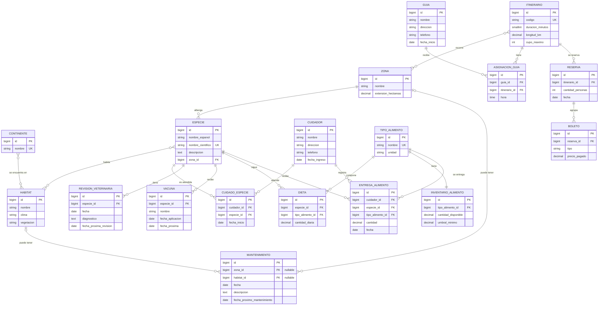

# ZooVerse

ZooVerse es un sistema académico web para la gestión de un zoológico. Permite administrar fauna, hábitats, zonas, personal, itinerarios, salud animal, alimentación, reservas, boletos y mantenimientos. Incluye reportes, estadísticas y un panel de alertas.

La especificación funcional de referencia está en [SRS_ZooVerse.md](./SRS_ZooVerse.md).

## Tecnologías

- Python 3.12
- Django 5.2
- PostgreSQL
- Django ORM y Django Admin
- `psycopg2-binary` y `python-dotenv`

## Requisitos previos

- Python 3.12 y `pip`.
- PostgreSQL instalado y en ejecución.
- Una base de datos PostgreSQL y un usuario con permisos sobre ella.

## Instalación en Windows

Ejecuta estos comandos desde la carpeta raíz del proyecto en PowerShell:

```powershell
py -3.12 -m venv .venv
.\.venv\Scripts\python.exe -m pip install --upgrade pip
.\.venv\Scripts\python.exe -m pip install -r requirements.txt
if (-not (Test-Path .env)) { Copy-Item .env.example .env }
```

Si `.env` ya existe, no lo sobrescribas: conserva tus valores locales.

### Configuración de PostgreSQL

1. Inicia el servicio de PostgreSQL.
2. Crea una base de datos (por ejemplo, `zooverse`) desde pgAdmin o ejecutando `CREATE DATABASE zooverse;`.
3. Edita `.env` y configura la clave secreta y los datos de conexión:

```dotenv
SECRET_KEY=una-clave-secreta-local
DEBUG=True
ALLOWED_HOSTS=127.0.0.1,localhost

DB_NAME=zooverse
DB_USER=postgres
DB_PASSWORD=tu-clave-de-postgres
DB_HOST=localhost
DB_PORT=5432
```

Puedes generar una clave para desarrollo con:

```powershell
.\.venv\Scripts\python.exe -c "from django.core.management.utils import get_random_secret_key; print(get_random_secret_key())"
```

No compartas ni subas `.env`: contiene credenciales locales y está excluido por Git. `.env.example` sirve como plantilla y no debe contener secretos reales.

### Migraciones, grupos y datos de prueba

Con PostgreSQL en ejecución y `.env` configurado:

```powershell
.\.venv\Scripts\python.exe manage.py check
.\.venv\Scripts\python.exe manage.py migrate
.\.venv\Scripts\python.exe manage.py configurar_roles
.\.venv\Scripts\python.exe manage.py seed_data
.\.venv\Scripts\python.exe manage.py createsuperuser
```

- `migrate` crea y actualiza las tablas de ZooVerse y de Django.
- `configurar_roles` crea o actualiza los grupos Administrador, Cuidador, Guía y Taquillero con los permisos definidos.
- `seed_data` carga datos de demostración y está diseñado para poder ejecutarse más de una vez; es opcional si no necesitas esos datos.
- `createsuperuser` crea una cuenta administrativa para iniciar sesión. Es independiente de los grupos de rol.

En una base de datos nueva, aplica las migraciones antes de usar el sistema. Ejecuta `configurar_roles` antes de asignar usuarios a esos grupos; ejecuta `seed_data` solo si quieres cargar los datos de demostración.

### Iniciar el servidor

```powershell
.\.venv\Scripts\python.exe manage.py runserver
```

- Django Admin: <http://127.0.0.1:8000/admin/>
- Reportes y estadísticas: <http://127.0.0.1:8000/reportes/>
- Panel de alertas: <http://127.0.0.1:8000/reportes/alertas/>

La página de bienvenida está disponible en <http://127.0.0.1:8000/>. Las vistas de reportes y alertas requieren iniciar sesión y pertenecer al grupo **Administrador** (o ser superusuario). Para detener el servidor, usa `Ctrl+C` en la terminal. PostgreSQL se gestiona por separado mediante su servicio.

### Pruebas y comprobaciones

```powershell
.\.venv\Scripts\python.exe manage.py test
.\.venv\Scripts\python.exe manage.py check
.\.venv\Scripts\python.exe manage.py makemigrations --check --dry-run
```

Las pruebas usan la configuración de base de datos de Django y verifican funcionalidades como validaciones de cupo, inventario, permisos y repetibilidad del seed.

## Organización del proyecto

| Ruta | Responsabilidad |
|---|---|
| `zooverse/` | Configuración del proyecto, conexión a PostgreSQL y rutas principales. |
| `fauna/` | Continentes, hábitats, zonas y especies. |
| `personal/` | Guías, cuidadores y asignaciones de cuidado. |
| `visitas/` | Itinerarios, asignaciones de guías, reservas y boletos. |
| `operaciones/` | Revisiones, vacunas, dietas, inventario, entregas, mantenimientos y comandos de gestión. |
| `reportes/` | Consultas agregadas, vistas, formularios, plantillas y alertas. |
| `*/migrations/` | Historial versionado de cambios en el esquema de base de datos. |

La presentación se implementa con Django Admin para el CRUD y con vistas y plantillas propias para reportes y alertas. Las reglas de integridad y negocio están principalmente en los modelos; las consultas agregadas para reportes están en `reportes/consultas.py`.

## Modelo entidad-relación

El siguiente diagrama resume las entidades y relaciones implementadas. Las tablas `AsignacionGuia`, `CuidadoEspecie` y `Dieta` materializan relaciones con atributos propios.



### Decisiones de diseño de datos

- Las relaciones N:M tienen tablas intermedias; `AsignacionGuia` almacena `hora` y `CuidadoEspecie` almacena `fecha_inicio`. `Dieta` relaciona especie y alimento con `cantidad_diaria`.
- `Itinerario.num_especies_distintas` es una propiedad calculada a partir de las zonas recorridas y sus especies; no se almacena como dato redundante.
- Cada boleto pertenece a una reserva. El itinerario y la fecha se obtienen de ella, evitando repetir esos datos en cada boleto. Una reserva controla el total de personas y la validación impide superar el cupo del itinerario en la fecha reservada.
- Una entrega descuenta la cantidad del inventario del alimento correspondiente; al eliminarla, el inventario se restaura. Las operaciones usan transacciones para mantener ambas cantidades consistentes.
- Una restricción de base de datos obliga a que cada mantenimiento tenga una sola ubicación: zona o hábitat, pero no ambas.
- Se usan llaves foráneas, restricciones de unicidad y validaciones positivas/no negativas para reforzar integridad. Hay índices en campos utilizados por consultas de fechas, reportes y alertas.

## Roles y permisos

Los grupos se crean con `manage.py configurar_roles`. Después, el superusuario puede asignar usuarios a los grupos desde Django Admin.

| Grupo | Alcance principal |
|---|---|
| Administrador | Consulta y gestión completa de los módulos del sistema; acceso a reportes y alertas. |
| Cuidador | Consulta especies y asignaciones; registra y actualiza revisiones y vacunas; registra entregas de alimento. |
| Guía | Consulta especies, zonas, itinerarios y asignaciones de guías. |
| Taquillero | Consulta itinerarios; crea y actualiza reservas; registra boletos. |

Los permisos de Django restringen las acciones del Admin por modelo. Los reportes y alertas están limitados a superusuarios y miembros de Administrador.

## Reportes, estadísticas y alertas

En `/reportes/` se encuentran:

- Especies por zona y hábitat.
- Itinerarios más solicitados por periodo.
- Ingresos por boletos agrupados por día, mes y tipo.
- Historial médico por especie.
- Consumo de alimento por especie y periodo.
- Ocupación promedio de itinerarios.
- Especie con más revisiones veterinarias.
- Alimentos más consumidos.

El panel `/reportes/alertas/` muestra vacunas vencidas o próximas a vencer en 15 días, revisiones pendientes según la próxima fecha registrada, inventario bajo umbral, mantenimientos vencidos e itinerarios que alcanzaron el cupo para el día actual.

Las cantidades de alimentos con unidades distintas no se suman entre sí. Para señalar el mayor consumo, se comparan unidades compatibles (masa, volumen o unidades), normalizando gramos a kilogramos y mililitros a litros.

## Trazabilidad de requisitos funcionales

| Requisito | Implementación |
|---|---|
| **RF01** Registrar especie con nombre común, científico y descripción. | Modelo `Especie`, Admin de `fauna`. |
| **RF02** Asociar una especie a uno o varios hábitats. | Relación N:M `Especie.habitats`; Admin de fauna. |
| **RF03** Asignar cada especie a una zona. | FK `Especie.zona`. |
| **RF04** Registrar hábitat con nombre, clima, vegetación y continentes. | Modelos `Habitat` y `Continente`, relación N:M; Admin de fauna. |
| **RF05** Registrar zona con nombre y extensión. | Modelo `Zona`; Admin de fauna. |
| **RF06** Registrar itinerarios, zonas y número de especies distintas. | Modelo `Itinerario`; relación N:M con `Zona`; propiedad calculada `num_especies_distintas`. |
| **RF07** Asignar guías a itinerarios con horario. | Modelo intermedio `AsignacionGuia`, con restricción de hora única por itinerario. |
| **RF08** No exceder el cupo máximo de visitantes reservados. | Validación transaccional del modelo `Reserva`, por itinerario y fecha. |
| **RF09** Registrar guías y sus datos laborales. | Modelo `Guia`; Admin de personal. |
| **RF10** Registrar cuidadores y sus datos laborales. | Modelo `Cuidador`; Admin de personal. |
| **RF11** Registrar qué cuidador atiende a qué especie y desde cuándo. | Modelo intermedio `CuidadoEspecie`. |
| **RF12** Registrar revisiones veterinarias. | Modelo `RevisionVeterinaria`, relacionado con especie; Admin de operaciones. |
| **RF13** Registrar vacunas y fecha de próxima aplicación. | Modelo `Vacuna`, relacionado con especie; panel de alertas. |
| **RF14** Definir dietas por especie, alimento y cantidad diaria. | Modelo intermedio `Dieta`; Admin de operaciones. |
| **RF15** Registrar entregas de alimento. | Modelo `EntregaAlimento`, con cuidador, especie, alimento, cantidad y fecha; descuenta inventario. |
| **RF16** Llevar inventario por tipo de alimento. | Modelos `TipoAlimento` e `InventarioAlimento`, con existencia y umbral mínimo. |
| **RF17** Vender boletos por tipo e itinerario. | Modelo `Boleto` relacionado con `Reserva`, de la que deriva itinerario y fecha. |
| **RF18** Reservar cupo y descontarlo del disponible. | Modelo `Reserva`; valida el cupo agregado por itinerario y fecha. |
| **RF19** Registrar mantenimiento de una zona o hábitat. | Modelo `Mantenimiento`; restricción XOR de ubicación y alerta por próxima fecha. |

## Consideraciones y alcance

- El SRS establece objetivos de rendimiento de 20 consultas simultáneas, menos de 4 segundos para reportes y menos de 2 segundos para operaciones individuales. Se añadieron índices para apoyar las consultas, pero esos umbrales **no se han certificado con pruebas de carga**.
- La ocupación promedio se calcula usando los días con reservas registradas; no se incluyen días sin reservas.
- El requisito de marcar asistencia de visitantes aparece en la descripción del rol de Guía del SRS, pero no forma parte de los RF01–RF19 implementados.
- La exportación a PDF o Excel se menciona como posibilidad en el SRS y no está implementada.
- Funciones futuras como ejemplares individuales, pagos electrónicos, aplicación móvil y nómina quedan fuera del alcance actual.
